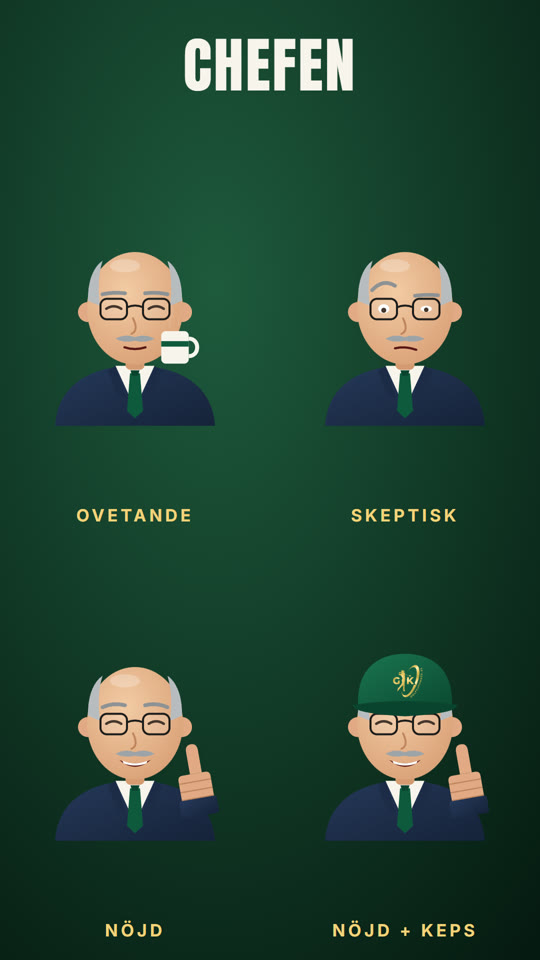

# Chefen – Tourleifs återkommande motspelare

Debuterade i "Ingen portal? Låt chefen betala din golf" (godkänd av Jonas 2026-10-14). Han är arbetsgivaren som
betalar friskvårdsbidraget – skeptisk först, nöjd sedan. Används tillsammans med **Tourleif**
(`library/templates/golfkuponger-tourleif/`) när en film behöver en chef, HR eller arbetsgivare.



## Utseende (ändra inte utan att fråga Jonas)

Flint med gråa tinningar, runda svarta glasögon, grå mustasch, marinblå kavaj, vit skjorta, grön slips (Golfkupongers
gröna). Med `cap: true` bär han samma Golfkuponger-keps som Tourleif (officiella loggan).

## Uttryck

| Uttryck | `expr` | Detaljer | Passar |
|---|---|---|---|
| Ovetande | `ovetande` | Dricker kaffe (`mug`), nöjd i sin värld | Innan han vet något |
| Skeptisk | `skeptisk` | Ena ögonbrynet uppe, läser | Granskar kvittot, tvekar |
| Nöjd | `nojd` | Ler, tummen upp (`thumbK` 0→1 animerar, `thumbY` flyttar handen ovanför ett skrivbord) | Godkänner, "chefen bjuder" |

```js
svg = `<defs>${tourleifDefs()}${chefenDefs()}</defs>` + chefen(t, { expr: 'nojd', x: 540, y: 860, s: 1, cap: true });
```

Karaktärsark: `node library/templates/golfkuponger-chefen/render_sheet.mjs`.
