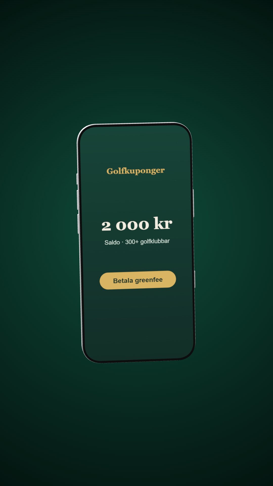

# 3D-telefonen

En riktig 3D-modell av iPhone 18 Pro (Silver) i three.js, med studioljus, reflexer i aluminiet, kameraplatå, knappar och
Apple-loggan. Skärmen är en canvas som filmen ritar appens riktiga skärmar i.

**Regel (Jonas 2026-11-27):** syns en telefon eller appen i en film används den här modellen, aldrig en platt
telefonram. Godkänd i ”Nya appen – reveal” (`work/gk-ny-app-reveal`, 2026-11-25).



## Använda den i en film

1. Kopiera `telefon3d.js` till filmens mapp och installera three.js där: `npm i three@0.180.0`.
2. I filmens HTML, före modulen:
   ```html
   <script type="importmap">{"imports":{"three":"./node_modules/three/build/three.module.js","three/addons/":"./node_modules/three/examples/jsm/"}}</script>
   <script>window.T3_STORLEK = { W: 1080, H: 1920 };</script>
   <script type="module" src="telefon3d.js"></script>
   ```
   Sidan måste köras över http eller i Playwright, eftersom ES-moduler inte laddas från `file://`.
3. Vänta tills `window.T3` finns. Rita sedan varje bildruta:
   ```js
   const g = T3.skarmDuk.getContext('2d');           // 620 × 1325 px (statusrad + skärm 620 × 1278)
   g.drawImage(appensSkarm, 0, 0, T3.SKARM.w, T3.SKARM.h);
   const bredd = 460;                                  // telefonens bredd i px
   const lage = { x: W / 2, y: 300, w: bredd };        // x = mitten, y = överkant
   const vrid = { rx, ry, rz, skala, z, dx, dy, axel: [x, y, z], vinkel };   // radianer; alla valfria
   X.drawImage(T3.rita(lage, vrid), 0, 0);             // T3.rita returnerar en genomskinlig duk i filmens storlek
   ```
4. `T3.projicera(u, v)` gör om en punkt på skärmen (i skärmdukens px) till filmens px, så att text, pilar eller ett
   kort som lyfter ut ur skärmen hamnar exakt rätt.

`demo.html` visar hela upplägget (`?format=9x16|16x9|4x5`, `?t=<sekund>` för en stillbild, `?skarm=<bild>`).
`still.mjs` gör en stillbild med Playwright: `node still.mjs http://localhost:8767/demo.html ut.jpg 2.2 16x9`.
Preview-servern heter `telefon3d` i `.claude/launch.json`.

## Rörelser som är godkända (från app-reveal-filmen, `telefon.js` → `vrid3d`)

- **Grunddrift:** långsamma sinusrörelser med olika perioder i alla tre axlar, t.ex. ry ±0,12 på 6,7 s och rx ±0,035
  på 9,1 s. Telefonen står aldrig helt still och upprepar sig aldrig.
- **Varv runt längdaxeln** (0,9 s, ease-in-out, skala +5 % mitt i): byt skärm exakt när baksidan är vänd mot kameran.
- **Kullerbytta framåt** runt tväraxeln, och ett **snett varv** runt en diagonal axel (`axel: [0.5, 1, 0.12]`).
- **Flyga in** från höger och långt bort (`z` från −1800 px till 0) eller in underifrån med baksidan först.
- **Tryck:** skalan −2 % och rx +0,05 under 0,4 s när en knapp trycks.
- **Inzoomning** mot en del av skärmen (skala +12 %, flytta nedåt så att överkanten står kvar under texten).

Jonas regel: *”inte alltid exakt samma rörelse”*. Varje telefonmoment får en egen rörelse.

## Premium

- Studioljuset är inbyggt. Lägg gärna ett varmt ljus bakom telefonen i filmens bakgrund (radial gradient).
- Skärmen ska visa **riktiga** skärmar ur appen (`work/_material/app-2026-11/`), aldrig påhittat gränssnitt.
- Behöver en scen ännu mer verklighet, som en hand som håller telefonen, golv eller reflexer i bordet: Blender
  (`tool-blender`) med samma mått, renderat med alfa och inlagt i filmen.
