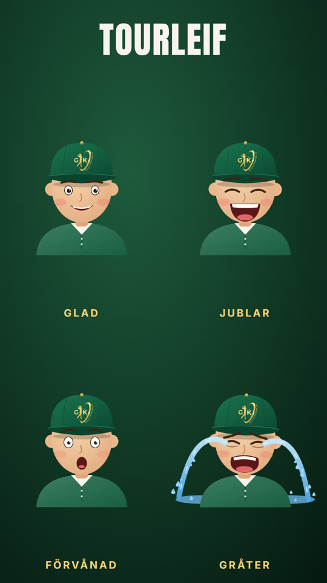

# Tourleif – Golfkupongers återkommande figur

Beslut av Jonas 2026-10-13: **Tourleif används alltid** när Golfkuponger gör tecknat/animerat innehåll med en person.
Han debuterade som den gråtande golfaren i årsskiftesfilmen (spola tillbaka-versionen) och fick sitt namn samma dag.



## Utseende (ändra inte utan att fråga Jonas)

- Grön golfkeps framifrån (#1B7552 → #0C4A33), guldknapp, mörkgrön skärm som skuggar pannan.
- **Golfkupongers riktiga logga** mitt fram på kepsen, som ett guldbroderi – den officiella
  `library/templates/golfkuponger-outro/assets/logo-final.png`, aldrig ritad eller AI-genererad.
- Grön piké (#1F6B4B) med krämvit krage (#F8F4EC) och två knappar. Varm hudton, rosiga kinder.
- Tecknad premiumstil som resten av Golfkuponger-illustrationerna (se `skills/golfkuponger-brand`, Tecknat).

## Uttryck

| Uttryck | `expr` | Rörelse | Passar |
|---|---|---|---|
| Glad | `glad` | Lugn andning, blinkar | Presentera, tipsa, "kolla här" |
| Jublar | `jublar` | Studsar | Golf! Kupongen, bollen i hål, vinst |
| Förvånad | `forvanad` | Blinkar | "Vänta…", insikt, vändpunkt |
| Gråter | `grat` | Snyftar, tårfontäner, pölar | För sent, bidraget brann inne |

## Använd honom

```js
// i sidan: <script src=".../tourleif.js"> + loggsymbolen (#gklogo) – se sheet.html
svg = `<defs>${tourleifDefs()}</defs>` + tourleif(t, { expr: 'jublar', x: 540, y: 860, s: 1 });
```

Normalskala: huvudets mitt i (540, 890), kroppen ner till y ≈ 1340 – håll ansikte och keps inom safe zones
(x 65–1015, y 270–1250). Ljud som passar: `sound.grat-man` (gråter), se `library/sounds`.

Karaktärsark och rörlig förhandsvisning: `node library/templates/golfkuponger-tourleif/render_sheet.mjs`.

## Nästa steg för figuren

Nya poser (helfigur som svingar, pekar, håller kupongen) läggs till som nya `expr`/funktioner här och visas för Jonas
innan de används. Filmade sketcher med en skådespelare (receptet `gk-recurring-character-sketch`) använder samma namn.
